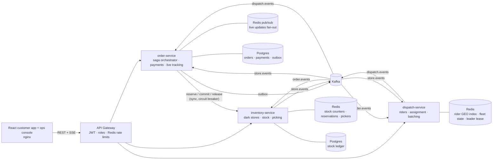
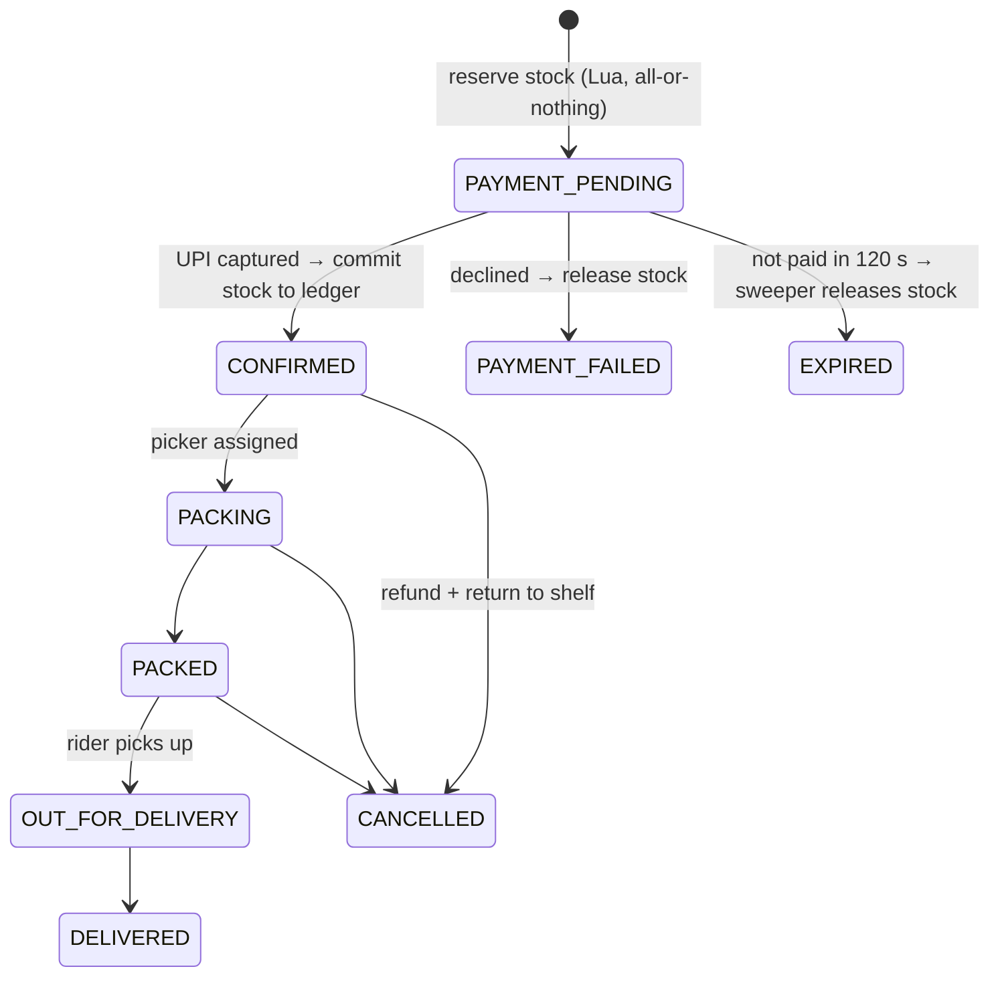

# SwiftKart

**The engine behind 10-minute grocery delivery: dark-store inventory that never oversells, an order
saga that survives failures, and rider dispatch with batching, all on a live map.**

Think Blinkit, Zepto or Swiggy Instamart. A customer opens the app, sees what the nearest dark store has
*right now*, pays, and a rider is at the door in about ten minutes.

`Java 21` · `Spring Boot 4` · `Spring Cloud Gateway` · `Kafka` · `Redis (Lua, GEO, pub/sub)` ·
`PostgreSQL` · `React 19 + Leaflet` · `Docker` · `Kubernetes`


> **Who is this page for?** Everyone. Start with [The problem](#the-problem) and the
> [flash-sale lab](#the-flash-sale-lab-the-headline-demo) for the product, [Run it](#run-it) and
> [How to test it](#how-to-test-it) to try it, and [How it works](docs/HOW-IT-WORKS.md) for the full
> walkthrough. Designers: see [For designers](#for-designers).

---

## The problem

Quick commerce runs on thin margins and tight promises. Three things break it.

1. **Overselling.** At 12 PM a limited deal drops and 300 people tap *Buy* in the same second for 50
   units. Naive code ("check stock, then decrement") tells all of them "reserved", takes their money,
   and then refunds most of them. Each refund costs a payment fee, a support ticket and a customer.
2. **Broken promises.** "10 minutes" is the product. A promise that ignores the picking queue or rider
   availability turns into a late order and a one-star review.
3. **Idle or overloaded riders.** Riders are the biggest cost. Every order needs a rider who can reach
   the store in time, work should be spread fairly, and two nearby orders should share one trip when
   that doesn't make either late.

## What SwiftKart does

| For | What they get |
|---|---|
| **Customers** | Pick a locality, see live stock from the nearest dark store ("only 3 left"), get an honest ETA, pay by UPI, and watch the rider move on a map until delivery. |
| **Dark-store teams** | Orders flow straight to pickers; stock can't go negative; a stock board shows what will run out first (sales velocity and hours of cover) with one-click restock. |
| **Operations** | A live city map of every rider, on-time rate against the promise, rider utilisation, orders waiting for a rider, surge staffing, and a **flash-sale lab** that proves the platform doesn't oversell. |

### The flash-sale lab (the headline demo)

300 simultaneous buyers, 50 PlayStation 5s, every buyer through the real checkout (reserve → pay → commit):

| Implementation | Told "reserved" | Confirmed | Refunded after paying |
|---|---|---|---|
| **Atomic Redis Lua** (production path) | 50 | 50 | **0** |
| Naive check-then-act (for comparison) | 174-300 | 50 | **124-250** |

These are measured results from the running system and the Testcontainers integration test. The atomic
path gives exactly the same result every run. The naive one varies with thread timing: across runs it
told between 174 and all 300 buyers "reserved". In every naive run the Postgres ledger still refused to
go negative, and the reconciler then repaired the phantom stock left in Redis.

---

## Architecture



### The order saga



## Engineering decisions (and why)

| Decision | Why |
|---|---|
| **A whole cart is reserved in one Redis Lua script** | Check-and-decrement for every line happens atomically: no lost updates, no half-reserved carts. Thousands of checkouts per second never touch the database. |
| **Redis Cluster hash tags** (`stock:{BLR-KOR}:sku`) | Every key for a store lands in the same slot, so multi-key Lua scripts stay atomic on a sharded cluster. |
| **Postgres is the ledger; Redis is the fast counter** | Units leave the ledger only when an order is paid (`UPDATE … WHERE on_hand >= qty`, idempotent per order). The ledger can never go negative, even if Redis is wrong. |
| **Commit = claim → ledger → finalize**, with compensation | Claiming takes the reservation away from the expiry sweeper, so a slow payment can't be both committed and released. If the ledger rejects (an oversell got through), the reservation is dropped without creating phantom stock. |
| **Reservations expire** (120 s) via a sorted set swept by every replica | Abandoned carts give stock back automatically. `ZREM` decides which replica releases each one, with no locks or double releases. |
| **A reconciler checks Redis against the ledger and live reservations every 30 s** | Repairs drift only when it is seen twice in a row, because a single observation may just be a checkout in flight. It also cleans up reservations stranded by a commit that died half-way. |
| **Orchestrated saga with a transactional outbox** | One service owns the order's state machine; events reach Kafka exactly when the database commit happens. |
| **Status only moves forward, with optimistic locking (`@Version`)** | Kafka events arrive out of order (a rider can be assigned while the order is still being packed). Late events can't move an order backwards, and concurrent updates retry instead of overwriting. |
| **Consumer-side de-duplication** (`processed_events`) | Kafka delivers at least once; every event is applied exactly once. |
| **Delivery promise = picking + queue ahead + handover + ride**, and the clock starts at payment | A realistic promise is what makes on-time rate a meaningful KPI. Time a customer spends in their UPI app doesn't count against the store. |
| **"Orders ahead" comes from an atomic per-store Redis gauge**, not a database count | Found in testing: during a flash sale, 50 checkouts in the same second each saw an empty queue and were all promised 7 minutes (actual: 25). Joining a sorted set returns each buyer's true queue position, so promises now range from 7 to 25 minutes. |
| **Rider candidates from a Redis GEO radius query**, then a score: time-to-store minus a fairness bonus for idle time | The same spatial-index query real dispatchers run on live GPS pings. Fairness spreads work instead of always picking whoever stands closest. |
| **Batching** when two drops are within 1.2 km and the detour is under 4 minutes | One trip, two deliveries: lower cost per order, higher rider earnings, and neither customer is late. |
| **Leader election with a fenced Redis lease** for the fleet simulation | Exactly one dispatch replica moves riders and assigns orders. Renewal is compare-and-extend, so a paused replica can't extend someone else's lease. Fleet state is snapshotted to Redis, so a new leader resumes seamlessly. |
| **Pick-and-pack timers are rows in a Redis sorted set, not in-memory timers** | A restart or a second replica never loses or duplicates a "packed" event. |
| **Live tracking over Server-Sent Events, fanned out with Redis pub/sub** | The browser may be connected to a different order-service replica than the one that consumed the Kafka event. |
| **Reservations fail closed** (circuit breaker), and services warm up and size Tomcat's accept queue for bursts | Never take money for stock that can't be held. Found in testing: the first flash sale after a deploy timed out on cold paths, and 300 simultaneous connections overflowed the default backlog of 100. |
| **Checkout gets a tighter per-user rate limit at the gateway** | Bots hammering a flash deal can't starve real customers. |

## Measured results (local Docker, demo clock 6× faster)

| Metric | Result |
|---|---|
| Flash sale, 300 buyers / 50 units | 50 confirmed, 250 told "sold out" before paying, 0 refunds, ~2 s end to end |
| Normal traffic (20 orders/min, 11 stores, 8 riders each) | **86% on time**, 9.2 min average delivery against a 10 min average promise |
| Under load (30 orders/min across 11 stores) | Batched trips form automatically. Overloading a store visibly raises "waiting for rider" until surge riders are added. |

---

## Run it

Requirements: Docker with about 4 GB of memory for containers.

```bash
docker compose up --build
open http://localhost:3002          # landing page; "Start shopping" opens the store (any name + 10-digit mobile)
open http://localhost:3002/ops      # ops control room: ops / swiftkart
```

1. In the store (`/shop`), choose a locality (Indiranagar, Bandra, Hauz Khas…), add items, pay, and watch the rider on the map.
2. In the ops control room, start the order load generator, then open the **Flash-sale lab** and run both modes.

The demo clock runs 6× faster (`TIME_SCALE`), so a 10-minute delivery takes under two minutes.

### Develop locally

```bash
docker compose -f docker-compose.infra.yml up -d
./mvnw package                      # build + 23 tests (Testcontainers needs Docker)
java -jar services/inventory-service/target/inventory-service-1.0.0.jar   # :8092
java -jar services/order-service/target/order-service-1.0.0.jar           # :8091
java -jar services/dispatch-service/target/dispatch-service-1.0.0.jar     # :8093
java -jar services/gateway/target/gateway-1.0.0.jar                       # :8080
cd frontend && npm install && npm run dev                                 # :5174
```

### Kubernetes

```bash
kubectl apply -k k8s/
```

The manifests include probes, resource limits, HPAs on checkout and inventory, PodDisruptionBudgets,
non-root read-only containers, an nginx Ingress with SSE settings, and NetworkPolicies so that only
order-service can reach stock reservations. dispatch-service runs two replicas: one leads, one stands by.

## API (via the gateway)

| Method | Path | Purpose |
|---|---|---|
| `POST` | `/api/auth/customer` · `/api/auth/ops` | Sign in (customer, or the ops role) |
| `GET` | `/api/stores/nearest?lat&lon` | Nearest serviceable dark store (Redis GEO) |
| `GET` | `/api/catalog?storeId=` | Catalogue with live availability |
| `POST` | `/api/orders` | Checkout: reserves stock (`Idempotency-Key` supported) |
| `POST` | `/api/orders/{id}/pay` · `/cancel` | Pay (mock UPI) or cancel |
| `GET` | `/api/orders/{id}/stream` | Server-Sent Events: live order status |
| `GET` | `/api/dispatch/orders/{id}/track` | Rider position and ETA |
| `GET` | `/api/ops/overview` · `/api/dispatch/stats` | KPIs |
| `POST` | `/api/ops/flash-sale` | Run the flash-sale experiment (`ATOMIC` or `NAIVE`) |
| `POST` | `/api/ops/simulator/start` · `/stop` | Order load generator |
| `GET` | `/api/inventory/ops/stores/{id}/stock` | Stock board with velocity and hours of cover |
| `POST` | `/api/inventory/ops/reconciliation/run` | Reconcile Redis against the ledger now |
| `POST` | `/api/dispatch/ops/riders` | Surge staffing |

## Project layout

```
contracts/                  Kafka event and API records shared by the services
services/gateway/           Spring Cloud Gateway: auth (customer + ops), roles, rate limits, routing
services/order-service/     Saga orchestrator, payments, outbox, SSE tracking, load generator, flash sale
services/inventory-service/ Dark stores, catalogue, Lua stock scripts, expiry sweeper, reconciler, picking
services/dispatch-service/  Rider fleet, GEO matching, batching, leader-elected simulation
frontend/                   React + TypeScript + Tailwind + Leaflet (customer app and ops console)
k8s/                        Kustomize manifests
docs/                       How it works, testing guide
scripts/                    End-to-end API smoke test
e2e/                        Playwright browser tests (full user journeys, phone-width layout)
```

## How to test it

- **Automated:** `./mvnw verify` runs 23 tests, including Testcontainers integration tests against
  **real Redis and Postgres**. They prove that 300 concurrent buyers for 50 units yield exactly 50
  reservations, that the naive path oversells, that carts are all-or-nothing, that commits are
  idempotent, that a ledger rejection leaves no phantom stock, and that simultaneous checkouts get
  distinct queue positions. Unit tests cover the order state machine, the ETA promise, and rider
  assignment, fairness and batching.
- **End to end:** with the stack running, `./scripts/smoke-test.sh` runs 14 checks, including a real
  order through to delivery and both flash-sale modes (about 3 minutes).
- **In a real browser:** with the stack running, `cd e2e && npm install && npx playwright install chromium && npm test`
  runs Playwright through the 22-step customer and ops journey: landing page, sign-in validation, location, cart, the 2-minute hold, payment, live tracking to delivery, a declined payment, a cancellation, the orders list, then the load generator, both flash-sale modes, a restock and reconciliation. It also checks that no page scrolls sideways on a 390 px phone.
- **By hand:** [docs/TESTING.md](docs/TESTING.md) is a click-by-click script with what you should see.

## For designers

- **Feel:** a warm, confident consumer brand. Cream backgrounds, deep green for action, saffron for
  highlights and the "ten minutes" promise. No emoji: products are drawn as tinted tiles with a line
  icon per aisle, so the catalogue reads as one consistent system.
- **Palette:** cream `#faf8f3`, ink `#1a1d1a`, brand green `#0b6b3a` (hover `#08542d`, soft `#e6f2ea`),
  saffron `#ffb020` (soft `#fff4dc`), danger `#c4382a`. Each aisle has its own tint and icon colour
  (`frontend/src/components/ProductArt.tsx`). Tokens are in `frontend/src/index.css`.
- **Type:** Bricolage Grotesque for display headings and prices that need personality, Inter for
  everything else, tabular figures for money and counts.
- **Motion:** the landing hero plays a real delivery (route drawn, rider driving it, countdown and status
  steps); the flash-sale section animates 300 buyers per system; the cart slides in; status changes
  animate on the tracking page. Everything respects "reduce motion".
- **Two audiences:** the store is mobile-friendly with a sticky header, category chips and a slide-in
  cart; the ops control room is a desktop dashboard with a dark sidebar, a live city map (muted
  OpenStreetMap with custom store, rider and customer pins) and KPI tiles.
- **Honesty is part of the design:** live stock ("only 3 left"), a promise that reflects the real queue,
  a visible 2-minute payment hold, "Free cancellation until the rider picks it up", and a clear
  "We're not in your area yet" state.
- **Open design questions:** substitutions when an item runs out mid-pick, rider ratings and tips, an
  accessible alternative to the map for tracking, and offline states.
- Components: `frontend/src/components/ui.tsx`, the map in `MapView.tsx`, the landing page in
  `frontend/src/landing/`. Run `npm run dev` in `frontend/` (set `API_TARGET=http://localhost:8082` to
  use the Docker stack's gateway).

## Honest limitations

- Payments, picking and rider movement are simulated. Riders move in straight lines at a road-adjusted
speed rather than along streets.
- Single Kafka broker and one Postgres instance with one database per service keep the demo light.
- Map tiles come from OpenStreetMap's public servers, which is fine for a demo but not for production traffic.

## Inspiration

- Public descriptions of quick-commerce operations (dark stores within a 2-3 km radius, real-time stock,
dynamic ETAs) from Blinkit, Zepto and Swiggy Instamart coverage.
- Rider assignment factors (first-mile distance, rider idle time, order delay) as described in Swiggy
engineering interviews and the Swiggy case studies on batching.
- [Batching and Matching for Food Delivery in Dynamic Road Networks](https://arxiv.org/abs/2008.12905) (evaluated on Swiggy data).
